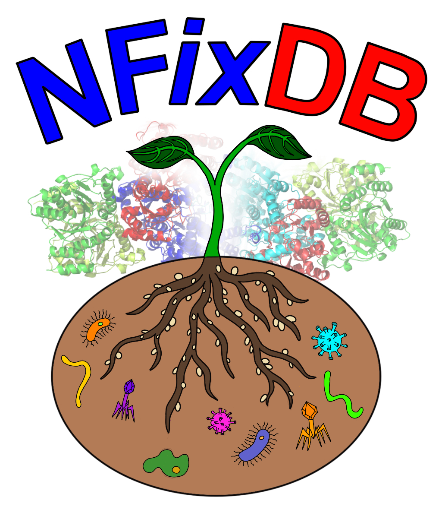

# 🧬 NFixDB

### *Explore the genes behind biological nitrogen fixation.*

<div align="center">

[](https://doi.org/10.1093/nargab/lqae063)
[](https://doi.org/10.5281/zenodo.11047211)
[](https://doi.org/10.5281/zenodo.10950414)
[](LICENSE)
[](https://github.com/raw-lab/NFixDB)

**🌱 Nitrogen fixation · 🧬 Genome-linked references · 🔎 HMM discovery · 🗃️ SQL + TSV**



**[Read the paper](https://pmc.ncbi.nlm.nih.gov/articles/PMC11155484/) · [Download the database](https://doi.org/10.5281/zenodo.10950414) · [Archived software](https://zenodo.org/records/11047211) · [Report an issue](https://github.com/raw-lab/NFixDB/issues)**

</div>

---

## 🔬 What is NFixDB?

**NFixDB — Nitrogen Fixation DataBase — connects nitrogenase sequences to their genomic and taxonomic context.** It brings together conventional nitrogenases, alternative nitrogenases, and related enzymes with genome-linked ribosomal RNA references in a resource for diazotroph research.

Use it to explore **which organisms carry nitrogenase-associated genes, which enzyme families those genes resemble, and how those sequences relate to reference genomes**.

The project combines a downloadable reference database with scripts for database construction and analysis. Start with the archived data for reference work; use the source workflow when you need to rebuild or extend the resource.

> **From genes to genomes to ecological questions.** NFixDB provides a foundation for studying nitrogen-fixing microorganisms and their potential contributions to sustainable agriculture.

## 🧭 Explore this README

- [Features](#-features)
- [Gene families](#-gene-families)
- [Scientific foundation](#-scientific-foundation)
- [Downloads and Zenodo records](#-downloads-and-zenodo-records)
- [Quick start](#-quick-start)
- [Screen your proteins](#-screen-your-proteins)
- [Build from source](#-build-from-source)
- [Workflow and outputs](#-workflow-and-outputs)
- [Interpretation and reproducibility](#-interpretation-and-reproducibility)
- [Citation](#-citation)
- [License](#-license)
- [Contributors and support](#-contributors-and-support)

---

## ✨ Features

| Capability | What it brings to your analysis |
| --- | --- |
| 🧬 Conventional nitrogenases | References for `nifH`, `nifD`, and `nifK` |
| ⚙️ Alternative nitrogenases | Coverage of `vnfHDK` and `anfHDK` |
| 🔎 Nitrogenase-like references | Related enzyme families for more informed annotation |
| 🌳 Genome-linked classification | A connection between functional genes and reference organisms |
| 🧫 Ribosomal RNA linkage | Ribosomal references connected through their source genomes |
| 🗃️ SQL database | Structured exploration and integration into analysis scripts |
| 📊 TSV exports | Tables accessible from Python, R, spreadsheets, or command-line tools |
| 🧩 Profile HMMs | Reusable models for protein-sequence screening |
| 📚 Sequence resources | FASTA and alignment archives for downstream analysis |
| 📦 Versioned archives | Citable snapshots for reproducible research |

### Research questions to build around NFixDB

- **Comparative genomics:** Which reference organisms carry the gene families relevant to your study?
- **Metagenomics and MAGs:** Which predicted proteins merit closer examination as nitrogenase candidates?
- **Microbial ecology:** How do candidate nitrogenase repertoires vary across communities or environments?
- **Evolution:** How do conventional, alternative, and related enzyme sequences compare?
- **Agricultural microbiomes:** Which candidates should be prioritized for genomic follow-up and experimental validation?

These are analysis directions enabled by the reference resources, rather than claims that every analysis is automated by a single NFixDB command.

## 🧬 Gene families

| Reference group | Genes | Role in the database |
| --- | --- | --- |
| Conventional nitrogenase | `nifH`, `nifD`, `nifK` | Core nitrogenase reference group |
| Alternative nitrogenase | `vnfH`, `vnfD`, `vnfK` | Alternative-family classification |
| Alternative nitrogenase | `anfH`, `anfD`, `anfK` | Alternative-family classification |
| Nitrogenase-like enzymes | `nfl` and chlorophyll/bacteriochlorophyll-related homologs | Related sequences that help contextualize a match |
| Ribosomal RNA references | 16S, 5S, 23S | Genome-linked marker context |

Use the identifiers in your selected FASTA, HMM, and database release when joining records. Keep gene-family labels, protein identifiers, and genome accessions as separate fields.

---

## 📖 Scientific foundation

The [2024 study](https://doi.org/10.1093/nargab/lqae063) screened more than **80,000 GTDB r214 representative genomes** using HMMs built from curated sequences. It linked assignments to GTDB and NCBI taxonomy and used genomic proximity and complete catalytic gene groups to strengthen classification. Ribosomal references were identified with barrnap.

Reported findings included **more than 4,000 `nifHDK` genes**, **more than 250 `anfHDK` genes**, and **approximately 60 `vnfHDK` genes**. These are gene counts, not organism counts. Complete catalytic groups occurred in roughly **16% of 181 examined phyla**. Comparisons against Buckley, Zehr, Mise, and FunGene resources examined redundancy and reassignment among related families.

These figures describe the published analysis, not a live count of the current repository or every subsequent database release.

### Version-aware filtering: read the correction

A [published correction](https://doi.org/10.1093/nargab/lqae164), dated **15 November 2024**, clarifies the filtering logic:

| Version discussed in the correction | Filtering distinction |
| --- | --- |
| **v2.1** | The published data used **OR** logic among the stated significance/score criteria, with an alignment-length requirement. |
| **v3.1** | The pipeline was updated to use the originally intended **AND** logic for the stricter criteria. |

The correction discusses E-value thresholds of `<9.9e-10` and `<9.9e-15`, a bit-score threshold of `>50`, and alignment length `>125`. Consult the selected version’s implementation for the stage-specific Boolean expression; these values are not interchangeable settings for one universal filter. The authors state that the correction does not change the article’s results, discussion, or conclusions.

**Record the software version and database version together.** An archived software release, a data deposit, and the current `main` branch are different reproducibility targets.

---

## 📦 Downloads and Zenodo records

### Software archive: v2.1

The requested [Zenodo record 11047211](https://zenodo.org/records/11047211) preserves **`raw-lab/NFixDB: Version 2.1`**, published **23 April 2024**, with changes responding to reviewer comments.

| Field | Archived value |
| --- | --- |
| Version | `v2.1` |
| Software DOI | [`10.5281/zenodo.11047211`](https://doi.org/10.5281/zenodo.11047211) |
| Software concept DOI | [`10.5281/zenodo.10472135`](https://doi.org/10.5281/zenodo.10472135) |
| Source snapshot | [`raw-lab/NFixDB`, tag `v2.1`](https://github.com/raw-lab/NFixDB/tree/v2.1) |
| Archive | `raw-lab/NFixDB-v2.1.zip` |
| Size | 53,046,422 bytes, approximately 53 MB |
| MD5 | `874a953ec2cfb96a321372cf06116a80` |

This is a **software snapshot**. Download the database resources separately when your analysis requires them.

### Database and supporting resources

The original README and publication link the database through [DOI `10.5281/zenodo.10950414`](https://doi.org/10.5281/zenodo.10950414). The separately indexed [data record 10975171](https://zenodo.org/records/10975171), labeled **3.1.0**, lists the following resources:

| File | Approximate size | Intended use |
| --- | ---: | --- |
| `NFixDB-R2.db` | 379.3 MB | SQL database exploration |
| `HMMs.zip` | 806.3 kB | Profile models |
| `fastas.zip` | 12.4 MB | Sequence references |
| `alignments.zip` | 38.5 MB | Alignment resources |
| `TSVs.zip` | 237.9 MB | Tabular data |
| `rRNA.zip` | 207.0 kB | Ribosomal references |
| `genomes.zip` | 7.6 GB | Genome resources |
| `clusters.zip` | 41.8 MB | Clustering resources |
| `oDB_results.zip` | 13.7 MB | External-database comparison results |
| `sword.zip` | 18.1 MB | Alignment comparison resources |
| `SupplementalTables.zip` | 73.2 MB | Supplementary tables |

The listed deposit totals approximately **8.5 GB**. Download only the components needed for your analysis. File inventories, access conditions, and licenses belong to each specific record; check the chosen record before downloading.

---

## ⚡ Quick start

### 1. Choose your starting point

| Goal | Start here |
| --- | --- |
| Explore curated records | SQL database or TSV archive |
| Screen predicted proteins | HMM archive |
| Compare reference sequences | FASTA and alignment archives |
| Revisit the archived software | Zenodo software v2.1 |
| Develop or rebuild the workflow | GitHub source plus the matching reference inputs |

### 2. Download the archived software

The following commands use the exact software file and checksum recorded by Zenodo:

```bash
mkdir -p nfixdb-work
cd nfixdb-work

curl --fail --location \
  'https://zenodo.org/api/records/11047211/files/raw-lab/NFixDB-v2.1.zip/content' \
  --output NFixDB-v2.1.zip

printf '%s\n' \
  '874a953ec2cfb96a321372cf06116a80  NFixDB-v2.1.zip' \
  | md5sum --check

unzip -l NFixDB-v2.1.zip
unzip NFixDB-v2.1.zip
```

On systems without `md5sum`, calculate the MD5 with the platform’s checksum utility and compare it with the value above.

### 3. Inspect the downloaded database

After downloading `NFixDB-R2.db` from the data deposit:

```bash
# Read-only access prevents accidental changes to the reference database.
sqlite3 -readonly NFixDB-R2.db '.tables'
sqlite3 -readonly NFixDB-R2.db '.schema'
```

Inspect the actual table and column names before writing a query. Do not assume that every release has an identical schema.

### 4. Explore from Python

This example lists tables and previews the first user table without assuming a particular schema:

```python
from pathlib import Path
import sqlite3

database = Path('NFixDB-R2.db').resolve()
if not database.is_file():
    raise FileNotFoundError(database)

connection = sqlite3.connect(database.as_uri() + '?mode=ro', uri=True)
try:
    tables = [row[0] for row in connection.execute(
        "SELECT name FROM sqlite_master "
        "WHERE type = 'table' AND name NOT LIKE 'sqlite_%' ORDER BY name"
    )]
    print('Tables:', tables)

    if tables:
        table = '"' + tables[0].replace('"', '""') + '"'
        cursor = connection.execute(f'SELECT * FROM {table} LIMIT 5')
        print('Columns:', [column[0] for column in cursor.description])
        for row in cursor:
            print(row)
finally:
    connection.close()
```

---

## 🔎 Screen your proteins

Use this as a **generic HMMER screening example**, not as a replacement for the complete NFixDB curation workflow.

**Inputs:** a protein FASTA (`proteins.faa`) and one selected HMM file from the downloaded archive. Preserve protein-to-contig and protein-to-genome mappings for follow-up.

```bash
mkdir -p results

# Replace this example path with an actual extracted HMM file.
HMM_FILE='/path/to/selected-model.hmm'

hmmsearch \
  --cpu 8 \
  --tblout results/hits.tbl \
  --domtblout results/domains.tbl \
  "$HMM_FILE" proteins.faa \
  > results/hmmsearch.txt
```

| Output | What to examine |
| --- | --- |
| `hits.tbl` | Target-level scores and significance |
| `domains.tbl` | Domain-level matches and alignment coordinates |
| `hmmsearch.txt` | Full search report and run details |

This command reports HMMER matches under its defaults. Apply the criteria appropriate to your chosen NFixDB version afterward. Evaluate competing family assignments and genomic context before making a biological call.

**Percent identity is a sequence-alignment statistic.** If your analysis requires it, calculate it against the relevant reference sequences; do not treat HMMER bit scores as percent identity.

---

## 🛠️ Build from source

### Get the repository

```bash
git clone https://github.com/raw-lab/NFixDB.git
cd NFixDB
git rev-parse HEAD
```

Keep the printed commit hash with your analysis. For the archived release, use its tag explicitly:

```bash
git checkout v2.1
```

### Dependencies and workflow selection

The inspected current `setup.py` declares **Python ≥3.8**, with `setuptools`, `configargparse`, `pandas`, `pyhmmer`, and `biopython`. The repository dependency script additionally lists **SQLite, MAFFT, HMMER, barrnap, and cerberus-x**.

For an editable installation inside your prepared environment:

```bash
python -m pip install -e .
python bin/nfixdb-workflow.py --help
```

The current workflow’s argument parser exposes:

| Option | Purpose |
| --- | --- |
| `--seeds` | Initial seed-sequence directory; required |
| `--gtdb` | GTDB directory; required |
| `--hmm-db` | Cerberus HMM database; required |
| `--output` | Output directory; default `results-NFixDB` |
| `--filter` | Enable filtering based on Cerberus results |
| `--threads` | Thread count; default `1` |

Example for that interface:

```bash
python bin/nfixdb-workflow.py \
  --seeds /path/to/seeds \
  --gtdb /path/to/GTDB \
  --hmm-db /path/to/cerberus-database.hmm \
  --output results-NFixDB \
  --threads 16
```

The inspected workflow expects `protein_faa_reps` and `protein_fna_reps` beneath the GTDB directory. It performs Cerberus checks even when `--filter` is omitted; that flag controls whether their filtered sequences are used.

**These commands document the inspected interface, not an end-to-end validated installation.** The v2.1 archive may use a different interface. Check the files and help output in your selected checkout, and configure matching taxonomy metadata and external databases before a full rebuild.

For cluster execution, inspect `workflow_sbatch.sh` before submission. Its module loading, environment names, reference paths, partition, and resource requests are site-specific. It also contains legacy script calls; verify that those scripts exist in your selected checkout.

---

## 🧱 Workflow and outputs

The current Python entry point organizes construction into these stages:

1. Check seed sequences with Cerberus and optionally filter them.
2. Align seeds, build profile HMMs, and screen GTDB proteins.
3. Attach taxonomy, select top hits, and analyze gene groups.
4. Extract nitrogenase sequences and check them with Cerberus.
5. Build final profiles from the extracted sequences.
6. Generate ribosomal references and connect them to filtered hits.
7. Produce the final tabular and SQL outputs.

### Output map for the inspected Python workflow

| Path under the output directory | Contents or role |
| --- | --- |
| `alignments/` | Seed alignment/model work |
| `combined.hmm` | Combined initial profiles |
| `gtdb-results/` | Reference screening results |
| `cerberus_results/` | Seed and extracted-sequence checks |
| `TSVs/evalue_taxonomy.tsv` | Hits linked to taxonomy |
| `TSVs/tophits.tsv` | Selected hits |
| `TSVs/filteredhits.tsv` | Hits retained after analysis |
| `fastas/` | Extracted protein sequences |
| `nitro-alignments/` | Final model-building work |
| `NFixDB.hmm` | Combined final profiles |
| `SSUs/` | Ribosomal sequence outputs |
| `TSVs/filteredhits_SSU.tsv` | Filtered hits with ribosomal information |
| `NFixDB.tsv` | Final tabular resource |
| `NFixDB.sql` | Final SQL output path |

Archived databases may use other names, including `NFixDB-R2.db`. Preserve the downloaded filename and inspect its format instead of assuming that `.sql` and `.db` are interchangeable.

## 🧠 Interpretation and reproducibility

### Make the evidence traceable

For every candidate, retain the protein ID, source genome or contig, model ID, score, E-value, alignment coordinates, filtering decision, and database release. This makes it easier to revisit ambiguous assignments and compare analyses across releases.

### Separate the biological questions

| Evidence | Question it helps address |
| --- | --- |
| Protein-profile match | Does this sequence resemble a reference family? |
| Gene complement and neighborhood | Is the genomic context consistent with the proposed assignment? |
| Transcript or protein measurements | Is there evidence of expression under the sampled conditions? |
| Functional measurements | Is nitrogen fixation occurring under those conditions? |

Treat incomplete assemblies carefully: missing genes may reflect assembly gaps. Conversely, a strong individual match should not be reported as direct proof of nitrogen fixation activity.

### Record these with every analysis

- Software tag or commit and the relevant correction/version notes.
- Exact data-record DOI, filenames, and checksums.
- GTDB release and taxonomy metadata used for a rebuild.
- Tool versions, command lines, thresholds, and Boolean filtering rules.
- Input identifiers and any gene-calling, dereplication, or post-processing steps.

---

## 📚 Citation

If you use NFixDB, cite the paper **and the specific software/data records used**.

**Paper**

Bellanger M, Figueroa JL, Tiemann L, Friesen ML, White RA III. 2024. NFixDB (Nitrogen Fixation DataBase)—a comprehensive integrated database for robust ‘omics analysis of diazotrophs. *NAR Genomics and Bioinformatics*. **6**(2):lqae063. [https://doi.org/10.1093/nargab/lqae063](https://doi.org/10.1093/nargab/lqae063).

```bibtex
@article{Bellanger2024NFixDB,
  author = {Bellanger, Madeline and Figueroa, Jose L. and Tiemann, Lisa
            and Friesen, Maren L. and {White III}, Richard Allen},
  title = {{NFixDB} ({Nitrogen Fixation DataBase})---a comprehensive
           integrated database for robust 'omics analysis of diazotrophs},
  journal = {NAR Genomics and Bioinformatics},
  year = {2024},
  volume = {6},
  number = {2},
  pages = {lqae063},
  doi = {10.1093/nargab/lqae063}
}
```

**Correction:** *NAR Genomics and Bioinformatics*. 2024;6(4):lqae164. [DOI: 10.1093/nargab/lqae164](https://doi.org/10.1093/nargab/lqae164).

**Archived software v2.1:** Bellanger M, RAW Lab, White RA III. *raw-lab/NFixDB: Version 2.1*. Zenodo, 23 April 2024. [DOI: 10.5281/zenodo.11047211](https://doi.org/10.5281/zenodo.11047211).

**Database:** Follow the citation exported by the exact [Zenodo data record](https://doi.org/10.5281/zenodo.10950414) you download. Cite its version-specific DOI when reporting a reproducible analysis.

## 📄 License

### Current supplied license: CC BY-NC 4.0

This README identifies the supplied project license as **Creative Commons Attribution–NonCommercial 4.0 (CC BY-NC 4.0)**. See [LICENSE](LICENSE) for the supplied terms and [the Creative Commons license](https://creativecommons.org/licenses/by-nc/4.0/) for the standard license text.

**Copyright © 2026 Richard Allen White III.**

The supplied `LICENSE` permits academic, research, and noncommercial use, copying, modification, and distribution subject to its conditions. Retain the copyright and permission notices. It requires prior written permission for commercial use and includes an “as is” warranty disclaimer.

**Commercial licensing:** [Richard Allen White III — rwhit101@charlotte.edu](mailto:rwhit101@charlotte.edu).

### Archived releases and metadata

The historical [Zenodo v2.1 software record](https://zenodo.org/records/11047211) lists **CC BY 4.0**, while the inspected current repository `setup.py` declares **BSD** metadata. Those entries differ from the supplied CC BY-NC 4.0 file. This README documents the supplied license; it does not change the license recorded for earlier deposits or update package metadata. Consult each downloaded release’s own license and record.

---

## 🤝 Contributors and support

| Contributor | Project affiliation |
| --- | --- |
| Madeline Bellanger | University of North Carolina at Charlotte |
| Jose L. Figueroa III | University of North Carolina at Charlotte |
| Dr. Lisa Tiemann | Michigan State University |
| Dr. Maren L. Friesen | Washington State University |
| Dr. Richard Allen White III | University of North Carolina at Charlotte |

Contributions are welcome: reference-sequence corrections, reproducibility improvements, clearer documentation, workflow fixes, and well-supported additions to the database.

When reporting a problem, include the software commit or tag, data release, command, relevant log excerpt, and a small reproducible example where possible.

- **Issues:** [raw-lab/NFixDB/issues](https://github.com/raw-lab/NFixDB/issues)
- **Project contact:** [Dr. Richard Allen White III](https://github.com/raw937) — [rwhit101@charlotte.edu](mailto:rwhit101@charlotte.edu)
- **Additional contact:** Madeline Bellanger — [mbellang@charlotte.edu](mailto:mbellang@charlotte.edu)

---

<div align="center">

### 🧬 NFixDB

**Discover the genes. Examine the context. Advance nitrogen-fixation research.**

Built by the **RAW Lab** and collaborators.

</div>
